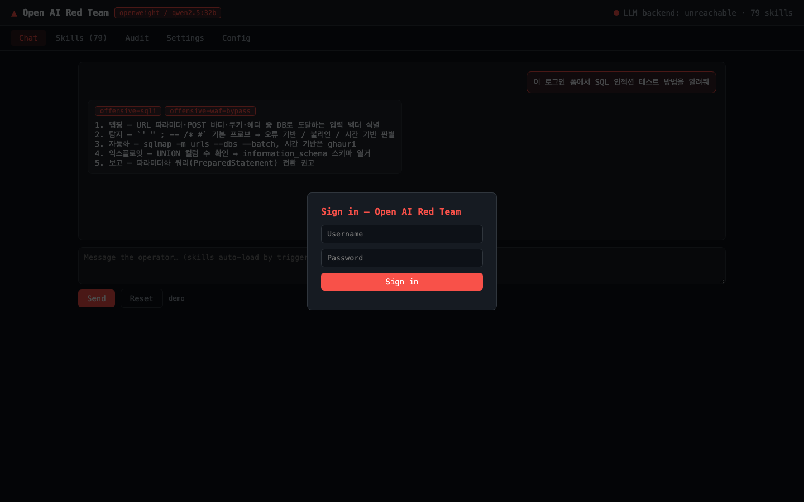
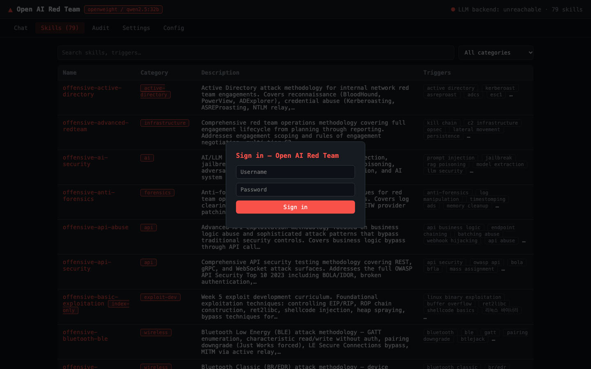
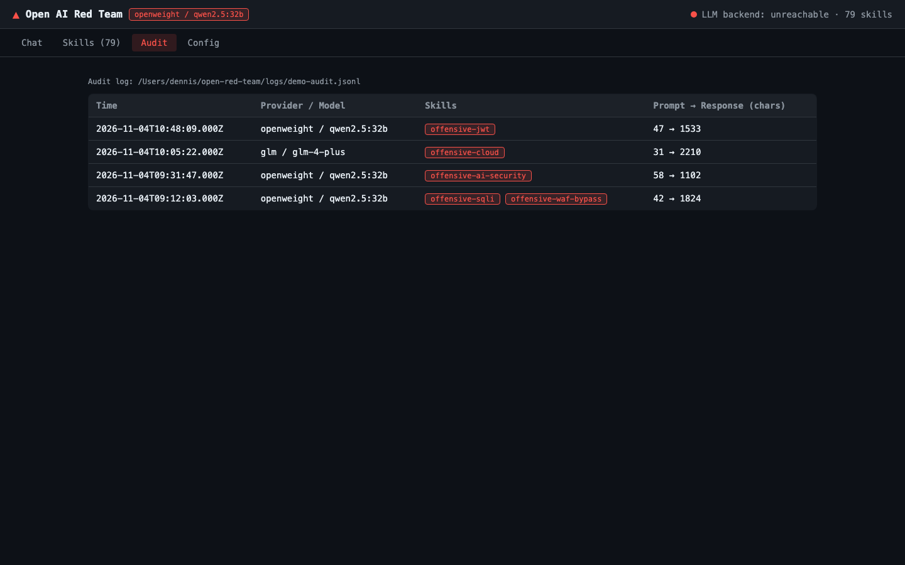
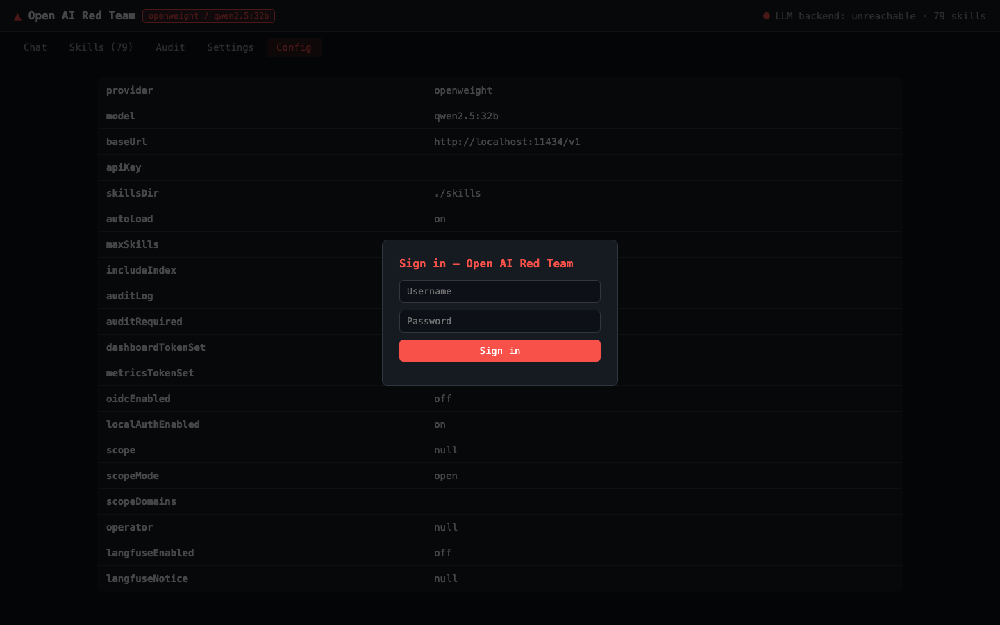

# Open AI Red Team

> **Claude Red の実証済みレッドチームスキルを DeepSeek、GLM、オープンウェイトモデルでも活用できるようにする、モデル非依存のレッドチーム方法論ミドルウェア**

**ドキュメント言語:** [English](README.md)（基準） · [한국어](README.ko.md) · 日本語（本ドキュメント） · [中文](README.zh.md)

## 概要

Open AI Red Team は、特定の LLM プロバイダーに依存したセキュリティスキルセットを多様なモデルで
再利用できるように設計された**モデル非依存のレッドチーム方法論ミドルウェア**です。
Anthropic Claude モデルに紐づいていた Claude Red スキルライブラリを、DeepSeek、GLM、そして
Ollama/vLLM 経由のオープンウェイトモデルへ移植することに焦点を当てています。

OpenAI 互換 API をサポートし、`openweight` プロバイダーを通じてモデルをローカル実行できるため、
**オンプレミスおよびエアギャップ環境**でも機密データを外部に出さずに運用できます。

## なぜ Open AI Red Team なのか — 主な強み

- **モデル非依存の設計**: 特定の LLM プロバイダーにロックインされません。OpenAI 互換 API と
  オープンウェイトモデルをサポートし、モデル選択の自由度を高めます。
- **オンプレミス/エアギャップ対応**: ローカルモデル実行によりデータ主権を確保し、閉域網でも
  レッドチーム方法論を活用できます。
- **大規模で実証済みのスキルライブラリ**: Claude Red の **79 スキル、23 カテゴリ**を移植。
  Web アプリケーション 16、インフラ/レッドチーム 7、エクスプロイト開発 6 などの実務的な攻撃
  方法論を体系的に分類しています。
- **エンタープライズ運用機能を内蔵**: Web ダッシュボード、JSONL 監査証跡、Prometheus メトリクス、
  OIDC 認証（Keycloak）、LangFuse トレーシングを提供。`ORT_SCOPE` によるスコープ指定や操作者帰属の
  監査記録などの安全ガードレールも含みます。
- **コンテキスト管理と多言語対応**: モデルごとのトークン制限を考慮したコンテキスト予算エンジンと
  大規模スキルの切り詰め機能を提供。英語、韓国語、日本語、中国語のドキュメントをサポートします。

## スクリーンショット

| ダッシュボード — Chat | ダッシュボード — Skills |
|-----------------------|-------------------------|
|  |  |
| **ダッシュボード — Audit** | **ダッシュボード — Settings** |
|  |  |

## 製品ポジショニングと境界

Open AI Red Team は**認可された作業のための方法論注入ミドルウェア**です。ホスト上でコマンドを
実行せず、ツール実行エージェントループも含みません。スキルに基づいて攻撃**方法**を提案しますが、
実際のスキャン、エクスプロイト、ポストエクスプロイトを自動実行するものではありません。

これは意図された製品境界です。自動化されたエンドツーエンドのレッドチーム実行が必要な場合は、
PyRIT や Decepticon など実行中心のフレームワークと組み合わせるのが適切です。

## 競合プロジェクト比較

| プロジェクト | 主なポジション | Open AI Red Team との関係 |
| :--- | :--- | :--- |
| **NVIDIA Garak** | 脆弱性スキャナー（検出中心） | 補完関係。Garak はスキャン、Open AI Red Team は方法論注入に特化 |
| **Microsoft PyRIT** | 自動攻撃オーケストレーター | 競合関係。Open AI Red Team にない実行エージェントループを提供 |
| **Promptfoo** | CI/CD 統合評価/レッドチーム | 競合関係。Open AI Red Team は CI/CD 統合よりもオンプレミス運用に重点 |
| **Decepticon / Pojun など** | 自律型攻撃エージェント | 別カテゴリ。実行自動化に注力 |

## 適した利用者

- Claude Red スキルを DeepSeek、GLM、オープンウェイトモデルでも使いたい組織
- データ主権とオンプレミス/エアギャップ運用を重視するセキュリティ組織
- 認可された範囲内で統制されたレッドチーム方法論支援を必要とするチーム

## クイックスタートとドキュメント

```bash
npm install
npm run build
cp .env.example .env
node dist/src/cli.js dashboard   # Webダッシュボード（http://localhost:8081）
```

ダッシュボード初回ログイン: **admin / admin**（パスワード変更を強制）。

- [ユーザーマニュアル](docs/manual.md) — インストール、プロバイダ、CLI、ダッシュボード、ガードレール、トラブルシューティング
- [デプロイ・運用](docs/deployment.md) — エアギャップ/オンプレミス 5階層アーキテクチャ
- [アーキテクチャ](docs/architecture.md) · [移植ガイド](docs/porting-guide.md) ·
  [モデルマトリクス](docs/model-matrix.md) · [コンプライアンス統制](docs/compliance.md) ·
  [ロードマップ](docs/roadmap.md)

## リリース

| バージョン | 内容 |
|------------|------|
| 0.1.0 | ミドルウェア + 最初の27スキル、プロバイダ抽象化、CLI、ドキュメント |
| 0.2.0 | claude-red全移植（79スキル/23カテゴリ）、多言語ドキュメント、マニュアル |
| 0.3.0 | Open AI Red Team へ名称変更 |
| 0.4.0 | トークン予算、テスト、スコープガードレール、LangFuse/OIDC/メトリクス、デプロイツール |
| 0.5.0 | スコープ拒否（0呼び出し）、セッション分離、履歴予算、fail-closed、PoC compose、シークレット必須化、検索基準線 |
| 0.6.0 | SQLiteローカルアカウント（admin/admin強制変更）、ダッシュボードSettingsタブ |

## 検証状況

全レビュー指摘（P0/P1/P2）はすべて解決・実測確認済みです —
[マニュアル — レビュー指摘と検証状況](docs/manual.md) を参照。

## ライセンス

MIT。元スキル: [SnailSploit/claude-red](https://github.com/SnailSploit/Claude-Red)（MIT）。
許可されたセキュリティテスト専用です。
