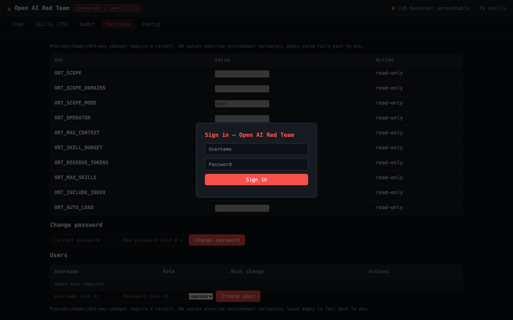
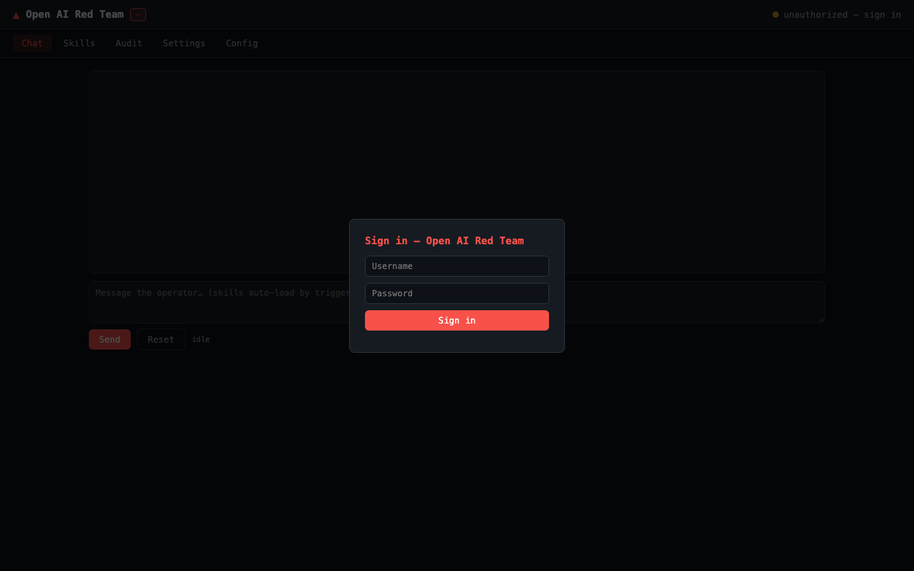

# Open AI Red Team

> **Claude Red의 검증된 레드팀 스킬을 DeepSeek, GLM, 오픈 웨이트 모델에서도 활용할 수 있게 하는 모델 불가지론적 레드팀 방법론 미들웨어**

**문서 언어:** [English](README.md)(기준) · 한국어(본 문서) · [日本語](README.ja.md) · [中文](README.zh.md)

## 개요

Open AI Red Team은 특정 LLM 제공자에 종속된 보안 스킬셋을 다양한 모델에서 재사용할 수 있도록 설계된
**모델 불가지론적 레드팀 방법론 미들웨어**입니다. Anthropic Claude 모델에 묶여 있던 Claude Red 스킬
라이브러리를 DeepSeek, GLM, 그리고 Ollama/vLLM 기반 오픈 웨이트 모델에서도 사용할 수 있도록 포팅하는
데 초점을 둡니다.

OpenAI 호환 API를 지원하며, `openweight` 제공자를 통해 모델을 로컬에서 실행할 수 있어
**온프레미스 및 에어갭 환경**에서도 민감한 데이터를 외부로 유출하지 않고 운영할 수 있습니다.

## 왜 Open AI Red Team인가 — 핵심 강점

- **모델 불가지론적 설계**: 특정 LLM 제공자에 종속되지 않습니다. OpenAI 호환 API와 오픈 웨이트
  모델을 지원해 모델 선택의 자유도를 높입니다.
- **온프레미스/에어갭 지원**: 로컬 모델 실행을 통해 데이터 주권을 확보하고, 폐쇄망에서도 레드팀
  방법론을 활용할 수 있습니다.
- **방대한 검증 스킬 라이브러리**: 기존 Claude Red의 **79개 스킬, 23개 카테고리**를 포팅했습니다.
  웹 애플리케이션 16개, 인프라/레드팀 7개, 익스플로잇 개발 6개 등 실무적인 공격 방법론이
  체계적으로 분류되어 있습니다.
- **엔터프라이즈 운영 기능 내장**: 웹 대시보드, JSONL 감사 추적, Prometheus 메트릭, OIDC 인증
  (Keycloak), LangFuse 트레이싱을 제공합니다. `ORT_SCOPE` 기반 범위 지정과 운영자 귀속 감사 기록
  등 안전 가드레일도 포함합니다.
- **컨텍스트 관리와 다국어 지원**: 모델별 토큰 제한을 고려한 컨텍스트 예산 엔진과 대형 스킬 절단
  기능을 제공합니다. 영어, 한국어, 일본어, 중국어 문서를 지원합니다.

## 스크린샷

| 대시보드 — Chat | 대시보드 — Skills |
|-----------------|-------------------|
|  |  |
| **대시보드 — Audit** | **대시보드 — Settings** |
|  |  |
| **대시보드 — Login** | **대시보드 — Config** |
|  |  |

## 제품 포지셔닝과 경계

Open AI Red Team은 **권한이 부여된 작업을 위한 방법론 주입 미들웨어**입니다. 호스트에서 명령을
실행하지 않으며, 도구 실행 에이전트 루프를 포함하지 않습니다. 즉, 스킬을 기반으로 공격 **방법**을
제안할 뿐, 실제 스캔·익스플로잇·후속 침투를 자동으로 수행하지는 않습니다.

이는 의도된 제품 경계입니다. 자동화된 엔드투엔드 레드팀이 필요하다면 PyRIT이나 Decepticon 같은
실행 중심 프레임워크와 결합하는 것이 적합합니다.

## 경쟁 프로젝트 비교

| 프로젝트 | 핵심 포지션 | Open AI Red Team과의 관계 |
| :--- | :--- | :--- |
| **NVIDIA Garak** | 취약점 스캐너(탐지 중심) | 상호보완적. Garak은 스캐닝, Open AI Red Team은 방법론 주입에 특화 |
| **Microsoft PyRIT** | 자동화된 공격 오케스트레이터 | 경쟁 관계. Open AI Red Team에 없는 실행 에이전트 루프 제공 |
| **Promptfoo** | CI/CD 통합 평가/레드팀 | 경쟁 관계. CI/CD 통합보다 온프레미스 운영에 초점 |
| **Decepticon / Pojun 등** | 자율 공격 에이전트 | 다른 카테고리. 실행 자동화에 중점 |

## 적합한 사용자

- Claude Red 스킬을 DeepSeek, GLM, 오픈 웨이트 모델에서도 쓰고 싶은 조직
- 데이터 주권과 온프레미스/에어갭 운영이 중요한 보안 조직
- 승인된 범위 안에서 통제된 레드팀 방법론 지원이 필요한 팀

## 빠른 시작 & 문서

```bash
npm install
npm run build
cp .env.example .env
node dist/src/cli.js dashboard   # 웹 대시보드 (http://localhost:8081)
```

대시보드 최초 로그인: **admin / admin** (비밀번호 변경 강제).

- [사용 매뉴얼](docs/manual.md) — 설치, 프로바이더, CLI, 대시보드, 가드레일, 트러블슈팅
- [배포 및 운영](docs/deployment.md) — 에어갭/온프레미스 5계층 아키텍처
- [아키텍처](docs/architecture.md) · [포팅 가이드](docs/porting-guide.md) ·
  [모델 매트릭스](docs/model-matrix.md) · [컴플라이언스 통제](docs/compliance.md) ·
  [로드맵](docs/roadmap.md)

## 릴리스

| 버전 | 내용 |
|------|------|
| 0.1.0 | 미들웨어 + 첫 27개 스킬, 프로바이더 추상화, CLI, 문서 |
| 0.2.0 | claude-red 전체 포팅(79개/23개 카테고리), 다국어 문서, 매뉴얼 |
| 0.3.0 | Open AI Red Team으로 명칭 변경 |
| 0.4.0 | 토큰 예산, 테스트, 스코프 가드레일, LangFuse/OIDC/메트릭, 배포 도구 |
| 0.5.0 | 범위 거절(0호출), 세션 분리, 히스토리 예산, fail-closed, PoC compose, 시크릿 필수화, 검색 기준선 |
| 0.6.0 | SQLite 로컬 계정(admin/admin 강제 변경), 대시보드 Settings 탭 |

## 검증 현황

전체 검토 지적(P0/P1/P2)은 모두 해소·실측 확인되었습니다 —
[매뉴얼 — 검토 지적 및 검증 현황](docs/manual.md) 참고.

## 라이선스

MIT. 원본 스킬: [SnailSploit/claude-red](https://github.com/SnailSploit/Claude-Red) (MIT).
허가된 보안 테스트 전용입니다.
