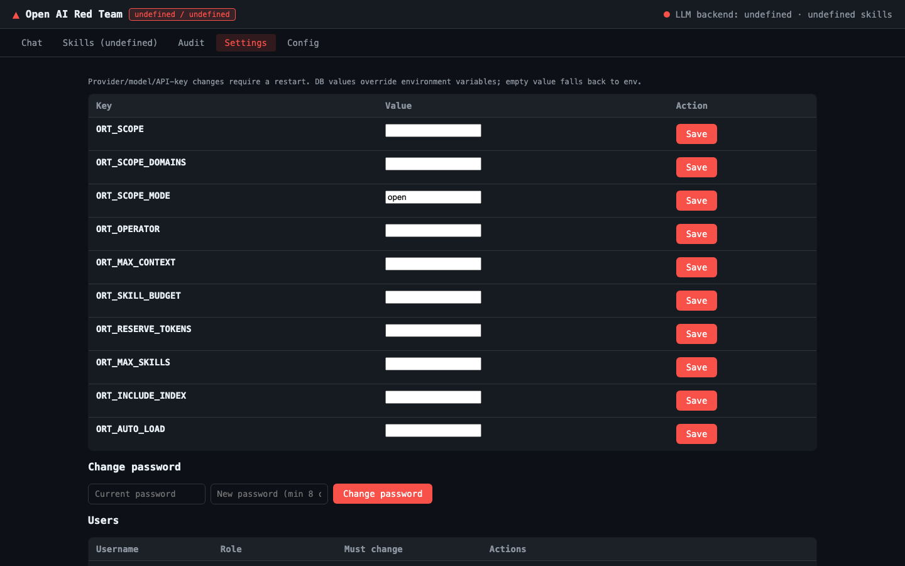
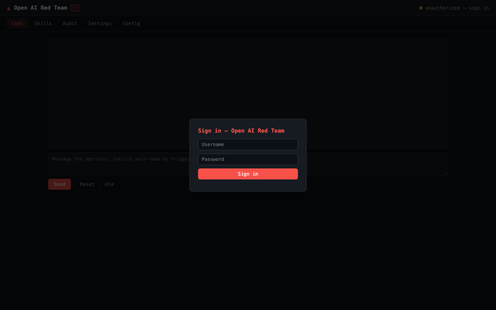

# Open AI Red Team

> **A model-agnostic red-team methodology middleware that lets you use proven Claude Red skills with DeepSeek, GLM, and open-weight models.**

**Documentation languages:** English (base) · [한국어](README.ko.md) · [日本語](README.ja.md) · [中文](README.zh.md)

## Overview

Open AI Red Team is a **model-agnostic red-team methodology middleware** designed to make security
skill sets reusable across different LLM providers. It ports the Claude Red skill library —
previously tied to Anthropic Claude models — to DeepSeek, GLM, and open-weight models running via
Ollama/vLLM.

It supports OpenAI-compatible APIs and can run models locally through the `openweight` provider,
enabling **on-premises and air-gapped operations** without sending sensitive data outside your
environment.

## Why Open AI Red Team — Key Strengths

- **Model-agnostic by design**: No lock-in to a single LLM provider. Supports OpenAI-compatible
  APIs and open-weight models, giving you freedom of model choice.
- **On-premises and air-gap support**: Local model execution helps preserve data sovereignty and
  enables red-team methodology use in isolated networks.
- **Extensive, proven skill library**: Ports **79 skills across 23 categories** from Claude Red,
  including 16 web application skills, 7 infrastructure/red-team skills, and 6 exploit
  development skills.
- **Built-in enterprise operations features**: Web dashboard, JSONL audit trails (with rotation),
  Prometheus metrics, OIDC authentication (Keycloak), and LangFuse tracing. Local accounts
  (SQLite) with rate-limited login, user management, and forced password change. Includes
  safety guardrails such as `ORT_SCOPE` scoping and operator-attributed audit records.
- **Context management and multilingual support**: A context budget engine and large-skill
  truncation help avoid context overflow. Documentation is available in English, Korean,
  Japanese, and Chinese.

## Port Status — full claude-red library (79 skills, 23 categories)

| Category | Skills | Category | Skills |
|----------|-------:|----------|-------:|
| Web Application | 16 | Fuzzing & Vuln Research | 4 |
| Infrastructure & Red Team | 7 | Reconnaissance | 2 |
| API Security | 2 | Container & Kubernetes | 2 |
| Cloud | 1 | CI/CD & Pipeline | 2 |
| AI Security | 1 | Cryptography | 2 |
| Active Directory | 2 | Privilege Escalation | 2 |
| Auth & Identity | 2 | Post-Exploitation | 3 |
| Wireless | 14 | Forensics & C2 | 2 |
| Mobile | 1 | Supply Chain | 2 |
| IoT & Embedded | 1 | Social Engineering | 2 |
| Exploit Development | 6 | Network Attacks | 1 |
| Utility | 2 | Total | 79 |

## Screenshots

| Dashboard — Chat | Dashboard — Skills |
|------------------|--------------------|
|  |  |
| **Dashboard — Audit** | **Dashboard — Settings** |
|  |  |
| **Dashboard — Login** | **Dashboard — Config** |
|  |  |

## Product Positioning and Boundaries

Open AI Red Team is a **methodology injection middleware for authorized work**. It does **not**
execute commands on the host and does **not** include a tool-execution agent loop. It suggests
attack **methodology** based on skills; it does not automatically perform scanning, exploitation,
or post-exploitation.

This is an intentional product boundary. If you need automated end-to-end red-team execution,
combine it with execution-focused frameworks such as PyRIT or Decepticon.

## Competitive Landscape

| Project | Core Position | Relationship to Open AI Red Team |
| :--- | :--- | :--- |
| **NVIDIA Garak** | Vulnerability scanner (detection-focused) | Complementary. Garak focuses on scanning; Open AI Red Team focuses on methodology injection |
| **Microsoft PyRIT** | Automated attack orchestrator | Competitive. Provides the execution agent loop that Open AI Red Team lacks |
| **Promptfoo** | CI/CD-integrated evaluation/red teaming | Competitive. Open AI Red Team focuses more on on-premises operations than CI/CD integration |
| **Decepticon / Pojun, etc.** | Autonomous attack agents | Different category. Focused on execution automation |

## Who It Is For

- Organizations that want to use Claude Red skills with DeepSeek, GLM, and open-weight models
- Security teams where data sovereignty and on-premises/air-gapped operations matter
- Teams that need controlled red-team methodology support within authorized scope

## Quickstart & Documentation

```bash
npm install
npm run build
cp .env.example .env
node dist/src/cli.js dashboard   # web dashboard (http://localhost:8081)
```

First dashboard login: **admin / admin** (forced password change).

- [User Manual](docs/manual.md) — install, providers, CLI, dashboard, guardrails, troubleshooting
- [Deployment & Operations](docs/deployment.md) — air-gapped/on-prem 5-layer architecture
- [Architecture](docs/architecture.md) · [Porting Guide](docs/porting-guide.md) ·
  [Model Matrix](docs/model-matrix.md) · [Compliance Controls](docs/compliance.md) ·
  [Roadmap](docs/roadmap.md)

## Releases

| Version | Contents |
|---------|----------|
| 0.1.0 | Middleware + first 27 skills, provider abstraction, CLI, docs |
| 0.2.0 | Full claude-red port (79 skills / 23 categories), multilingual docs, manual |
| 0.3.0 | Renamed to Open AI Red Team |
| 0.4.0 | Token budget, tests, scope guardrails, LangFuse/OIDC/metrics, deployment tooling |
| 0.5.0 | Scope denial (0 calls), session isolation, history budget, fail-closed, PoC compose, required secrets, retrieval baseline |
| 0.6.0 | SQLite local accounts (admin/admin forced change), dashboard Settings tab |

## Verification Status

All review findings (P0/P1/P2) are resolved and measured — see
[Manual — Review Findings & Verification Status](docs/manual.md).

## License

MIT. Original skills: [SnailSploit/claude-red](https://github.com/SnailSploit/Claude-Red) (MIT).
For authorized security testing only.
