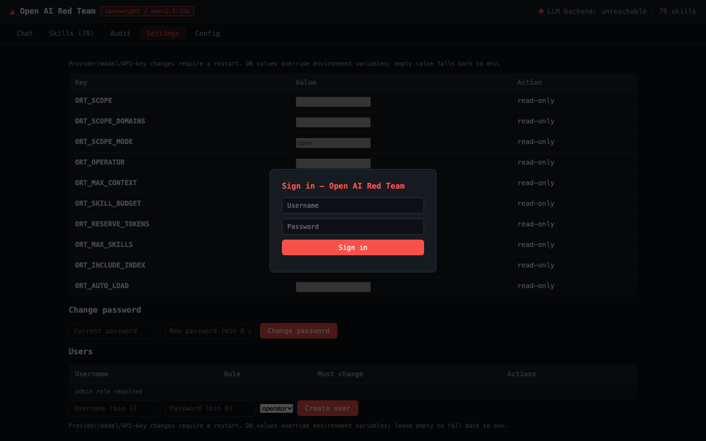
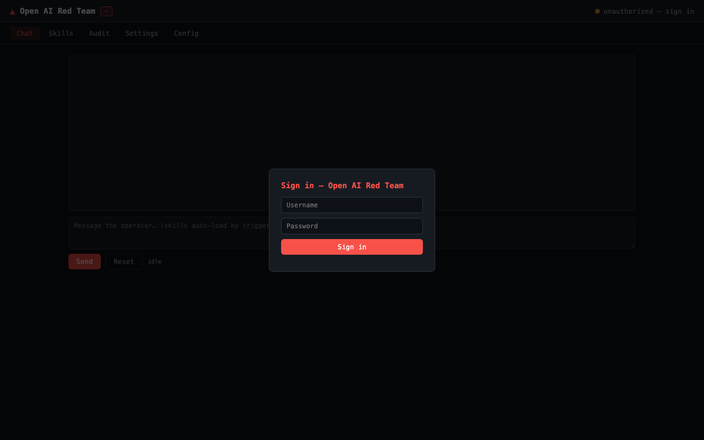

# Open AI Red Team

> **一个模型无关的红队方法论中间件，让经过验证的 Claude Red 技能可用于 DeepSeek、GLM 和开放权重模型。**

**文档语言:** [English](README.md)（基准） · [한국어](README.ko.md) · [日本語](README.ja.md) · 中文（本文档）

## 概述

Open AI Red Team 是一个**模型无关的红队方法论中间件**，旨在让安全技能集能够在不同 LLM 提供商
之间复用。它将原本绑定于 Anthropic Claude 模型的 Claude Red 技能库移植到 DeepSeek、GLM 以及
通过 Ollama/vLLM 运行的开放权重模型上。

它支持 OpenAI 兼容 API，并可通过 `openweight` 提供程序在本地运行模型，从而支持
**本地部署和气隙/隔离环境**，避免敏感数据外泄。

## 为什么选择 Open AI Red Team — 核心优势

- **模型无关设计**：不锁定单一 LLM 提供商。支持 OpenAI 兼容 API 和开放权重模型，提高模型选择
  自由度。
- **本地部署与气隙支持**：通过本地模型运行保障数据主权，并可在隔离网络中继续使用红队方法论。
- **庞大且经过验证的技能库**：移植了 Claude Red 的 **79 项技能、23 个类别**，包括 16 项
  Web 应用技能、7 项基础设施/红队技能和 6 项漏洞利用开发技能。
- **内置企业级运营功能**：提供 Web 仪表盘、JSONL 审计追踪、Prometheus 指标、OIDC 认证
  （Keycloak）和 LangFuse 追踪。还包含 `ORT_SCOPE` 范围限定和操作员归属审计等安全护栏。
- **上下文管理与多语言支持**：提供上下文预算引擎和大技能截断功能，避免上下文溢出。文档支持
  英语、韩语、日语和中文。

## 截图

| 管理面板 — Chat | 管理面板 — Skills |
|-----------------|-------------------|
|  |  |
| **管理面板 — Audit** | **管理面板 — Settings** |
|  |  |
| **管理面板 — Login** | **管理面板 — Config** |
|  |  |

## 产品定位与边界

Open AI Red Team 是**面向授权工作的方法论注入中间件**。它**不会**在主机上执行命令，也**不包含**
工具执行代理循环。它基于技能提出攻击**方法**，但不会自动执行扫描、漏洞利用或后渗透。

这是有意的产品边界。如果需要自动化的端到端红队执行，应将其与 PyRIT、Decepticon 等以执行为中心
的框架结合使用。

## 竞争项目对比

| 项目 | 核心定位 | 与 Open AI Red Team 的关系 |
| :--- | :--- | :--- |
| **NVIDIA Garak** | 漏洞扫描器（以检测为中心） | 互补。Garak 侧重扫描，Open AI Red Team 侧重方法论注入 |
| **Microsoft PyRIT** | 自动化攻击编排器 | 竞争关系。提供 Open AI Red Team 所缺少的执行代理循环 |
| **Promptfoo** | CI/CD 集成评估/红队 | 竞争关系。Open AI Red Team 更侧重本地运营而非 CI/CD 集成 |
| **Decepticon / Pojun 等** | 自主攻击代理 | 不同类别。侧重执行自动化 |

## 适用对象

- 希望将 Claude Red 技能用于 DeepSeek、GLM 和开放权重模型的组织
- 重视数据主权和本地/气隙运营的安全团队
- 需要在授权范围内获得受控红队方法论支持的团队

## 快速开始与文档

```bash
npm install
npm run build
cp .env.example .env
node dist/src/cli.js dashboard   # Web 管理面板（http://localhost:8081）
```

面板首次登录：**admin / admin**（强制改密）。

- [用户手册](docs/manual.md) — 安装、提供商、CLI、面板、护栏、故障排查
- [部署与运营](docs/deployment.md) — 物理隔离/本地部署 5 层架构
- [架构](docs/architecture.md) · [移植指南](docs/porting-guide.md) ·
  [模型矩阵](docs/model-matrix.md) · [合规控制](docs/compliance.md) ·
  [路线图](docs/roadmap.md)

## 版本

| 版本 | 内容 |
|------|------|
| 0.1.0 | 中间件 + 首批 27 个技能、提供商抽象、CLI、文档 |
| 0.2.0 | claude-red 全量移植（79 技能/23 类别）、多语言文档、手册 |
| 0.3.0 | 更名为 Open AI Red Team |
| 0.4.0 | 令牌预算、测试、范围护栏、LangFuse/OIDC/指标、部署工具 |
| 0.5.0 | 范围拒绝（0 调用）、会话隔离、历史预算、fail-closed、PoC compose、必需密钥、检索基准 |
| 0.6.0 | SQLite 本地账户（admin/admin 强制改密）、面板 Settings 页 |

## 验证状态

全部评审意见（P0/P1/P2）均已解决并经实测确认 —
参见[手册 — 评审意见与验证状态](docs/manual.md)。

## 许可证

MIT。原始技能：[SnailSploit/claude-red](https://github.com/SnailSploit/Claude-Red)（MIT）。
仅限授权安全测试。
