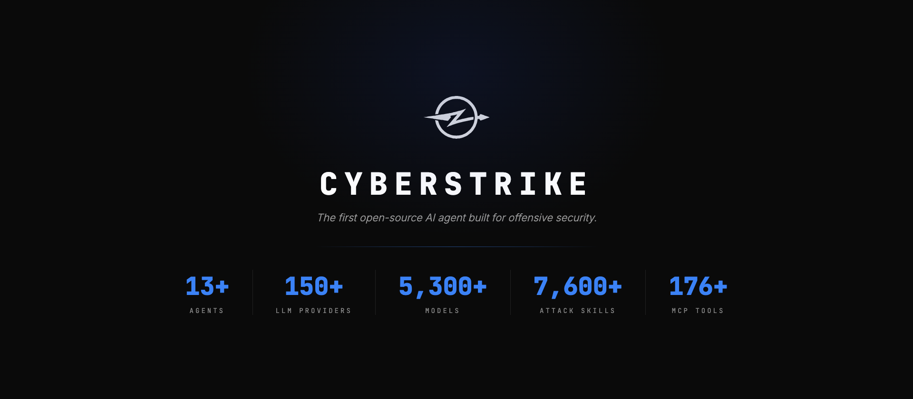

# CyberStrike 완전 가이드

> **Open-source AI-powered offensive security harness** — 대상을 설명하면 도구 선택·에이전트 배치·취약점 테스트·보고서 작성을 자율 수행하는 AI 기반 공격적 보안 하네스.
> 본 문서는 **공식 문서(docs.cyberstrike.io, 한국어판 · v1.1.16)** 와 **공식 저장소 README**를 종합해 재구성한 통합 가이드입니다. 이 오픈 소스의 목표와 특징부터 설치·실전 사용(어떻게)까지 하나로 다룹니다.



| 항목 | 값 |
| :--- | :--- |
| 공식 문서(한글) | <https://docs.cyberstrike.io/ko/docs/getting-started/> |
| 저장소 | <https://github.com/CyberStrikeus/CyberStrike> |
| 공식 사이트 | <https://cyberstrike.io> |
| 버전 기준 | v1.1.16 |
| 라이선스 | AGPL-3.0-only (개인·오픈소스 무료, 상용 별도) |
| 언어 | TypeScript |
| 커뮤니티 | <https://discord.gg/dr97wVJVbn> |

> **수치 표기 안내** — 프로젝트의 공식 문서와 README는 세부 수치(에이전트·도구·모델 수 등)를 서로 다르게 집계합니다. 본 가이드는 **최신 공식 문서(v1.1.16) 수치**를 기준으로 통일했습니다.

> 📁 **이미지 안내** — 이 문서는 모든 그림을 **`images/` 폴더의 로컬 파일**로 삽입합니다(원격 링크가 아니므로 뷰어·GitHub·오프라인에서 안정적으로 표시됩니다). 함께 배포할 파일: **`CyberStrike-완전가이드.md` + `images/` 폴더**.
> - 바로 표시되는 이미지: 히어로 배너(`images/hero-dark.png`), 아키텍처 인포그래픽(`images/CyberStrike-아키텍처.svg`)
> - 공식 스크린샷 5종(TUI·인증·첫 실행)은 별도 문서 사이트 자산이라 동봉되어 있지 않습니다. 아래 명령 한 번으로 `images/`에 받으면 즉시 표시됩니다(또는 본인이 직접 캡처한 이미지를 같은 파일명으로 넣어 교체):
> ```bash
> bash images/download-screenshots.sh
> ```
> Windows(또는 스크립트 미사용)라면 아래 URL을 브라우저에서 저장해 `images/`에 같은 파일명으로 두세요.
> - `g01-first-run.gif` · `s01-installation.png` · `g02-auth-login.gif` · `s02-auth.jpg` · `s03-tui-main.png`
> - 원본 경로: `https://docs.cyberstrike.io/docs/images/{gifs|screenshots}/<파일명>`

---

## 사용 전 반드시 읽을 것

> - CyberStrike는 **명시적·서면 허가를 받은 시스템**에만 사용합니다. 권한 없는 대상 테스트는 **불법**이며, 한국에서는 「정보통신망법」 위반에 해당할 수 있습니다(형사 처벌 대상).
> - **에이전트는 샌드박싱되지 않습니다.** 권한 시스템은 "실행 전 확인"을 돕는 UX 기능일 뿐, 보안 격리가 아닙니다. 실제 격리가 필요하면 **Docker 컨테이너 또는 VM 안에서 실행**하세요(공식 SECURITY.md 권고).
> - 자율 에이전트는 셸 실행·파일 조작 등 강력한 행위를 **승인 없이 연쇄**할 수 있습니다. 범위(scope)를 제한하고 실행을 모니터링하세요.
> - 포스트 익스플로잇(자격증명 추출·권한 상승·지속성 등) 기능은 계약 범위에서 명시적으로 허용된 경우에만 사용합니다.
> - 설치 스크립트(`curl … | bash`, `iwr … | iex`)는 **실행 전 내용을 검토**하세요.

---

## 목차

**Part 1 — 개요 (왜 / 무엇)**
1. [CyberStrike란?](#1-cyberstrike란)
2. [인텔리전스 레이어](#2-인텔리전스-레이어)
3. [아키텍처 개요](#3-아키텍처-개요)
4. [주요 사양 & 하네스 구성 요소](#4-주요-사양--하네스-구성-요소)
5. [에이전트 구조](#5-에이전트-구조)
6. [핵심 기능 — Vortex · HackBrowser · Bolt · MCP](#6-핵심-기능--vortex--hackbrowser--bolt--mcp)
7. [주요 장점](#7-주요-장점)
8. [주요 단점 및 한계](#8-주요-단점-및-한계)
9. [유사 프로젝트 비교](#9-유사-프로젝트-비교)

**Part 2 — 시작하기 (어떻게)**
10. [시스템 요구 사항](#10-시스템-요구-사항)
11. [설치](#11-설치)
12. [AI 제공자 연결 및 인증](#12-ai-제공자-연결-및-인증)
13. [첫 번째 평가 실행](#13-첫-번째-평가-실행)
14. [구성(Configuration)](#14-구성configuration)
15. [주요 슬래시 명령](#15-주요-슬래시-명령)
16. [키보드 단축키](#16-키보드-단축키)

**Part 3 — 실전 & 운영**
17. [실전 시나리오](#17-실전-시나리오)
18. [트러블슈팅 & 팁](#18-트러블슈팅--팁)
19. [안전 사용 가이드라인](#19-안전-사용-가이드라인)
20. [레퍼런스](#20-레퍼런스)

---

# Part 1 — 개요

## 1. CyberStrike란?

CyberStrike는 **AI 펜테스터가 함께 일하는** 구조입니다. 웹 앱·API·네트워크 같은 대상을 설명하면, 하나의 **대화형 인터페이스**로 제어를 유지하는 동안 하네스가 크롤링·트래픽 분석·인젝션 테스트·권한 검사·결과 간 체인 발견 등 무거운 작업을 처리합니다.

```
정찰(Reconnaissance) → 취약점 발견(Discovery) → 익스플로잇(Exploitation) → 보고서(Reporting)
```

핵심은 단순한 LLM 래퍼가 아니라, LLM 위에 얹히는 **인텔리전스 레이어**라는 점입니다. 어떤 모델을 연결하든 OWASP 테스트 방법론·취약점 패턴·공격 체인 추론을 주입하여 해당 모델을 보안 전문가처럼 작동하게 만듭니다.

**누구를 위한 도구인가**

- **펜테스터** — 정찰·초기 테스트 등 반복 작업을 위임하고 창의적 공격 체인에 집중
- **버그바운티 헌터** — 빠른 정찰, 넓은 커버리지, 프로그램 간 일관된 방법론
- **보안팀** — 재현 가능한 OWASP 평가와 표준 기반 보고서
- **보안 연구자** — 커스텀 에이전트·MCP 서버로 확장 가능한 플랫폼


---

## 2. 인텔리전스 레이어

LLM 제공자를 연결하면 CyberStrike가 매 상호작용에 도메인 컨텍스트(OWASP 방법론·취약점 패턴·공격 체인 추론·도구 오케스트레이션)를 주입합니다. 모델이 보안을 알 필요 없이, CyberStrike가 가르칩니다.

- **스키마 정규화** — 제공자별 응답 형식 차이와 무관하게 구조화된 출력 확보
- **컨텍스트 가드** — 프롬프트 누출 방지, 현재 테스트 단계에 집중 유지
- **제공자 자동 감지** — LLM 엔드포인트 자동 식별 및 최적 전송 방식 구성
- **도구 오케스트레이션** — 고정 스크립트가 아니라 발견 사항에 따라 도구를 지능적으로 연쇄

---

## 3. 아키텍처 개요


> 인터페이스(TUI·CLI·Web UI) → 인텔리전스 레이어 → 핵심 3요소(에이전트·WSTG 스크립트·도구) → 실행/원격(HackBrowser·Vortex·Bolt·Cloudflare Tunnel) → LLM 백엔드 순으로 구성되며, 전 과정은 **정찰 → 발견 → 익스플로잇 → 보고서** 파이프라인으로 자율 수행됩니다.

---

## 4. 주요 사양 & 하네스 구성 요소

### 4.1 주요 사양 (공식 문서 기준)

| 구분 | 수치 |
| :--- | :--- |
| 전문 에이전트 | 15개 이상 |
| 보안 도구 | 100개 이상(내장) |
| WSTG 결정론적 테스트 스크립트 | 65개 이상 |
| 컨테이너화 보안 도구(Bolt) | 30개 이상 |
| 내장 MCP 서버 | 3종(github-security·cve·osint) + 커스텀 |
| 지원 AI 제공자 | 230개 이상 |
| 지원 모델 | 9,000개 이상 |

### 4.2 하네스 구성 요소

| 레이어 | 내용 |
| :--- | :--- |
| **에이전트** | 15개 이상 — WSTG 파이프라인, 분류(triage), 에스컬레이션, general, explore |
| **도구** | 100개 이상 내장 — HTTP 재생, 인젝션 프로브, 접근 프로브, 정찰, 코드 검색 |
| **스킬** | 65개 이상 결정론적 WSTG 테스트 스크립트(런타임 로드) |
| **Vortex** | DSL 쿼리·규칙 매칭·신호 상관관계 기반 HTTP 트래픽 엔진 |
| **HackBrowser** | UI 컨텍스트 캡처가 가능한 AI 기반 Chromium 크롤러 |
| **Bolt** | 30개 이상 컨테이너화 보안 도구(nmap, nuclei, sqlmap, hydra 등) |
| **MCP** | 내장 3종 + 커스텀 MCP 서버 |

> 사용자는 **하나의 프롬프트**로만 상호작용하고, 나머지는 하네스가 조율합니다.

### 4.3 지원 LLM 제공자(일부)

| 제공자 | 무료 티어 | 인증 방법 |
| :--- | :--- | :--- |
| GitHub Copilot | 구독 포함 | OAuth (API 키 불필요) |
| OpenRouter | 예 | API 키 |
| Anthropic | 아니요 | API 키 |
| OpenAI | 아니요 | API 키 |
| Google Gemini | 예 | API 키 |
| Ollama / LM Studio | 예 (로컬) | 없음 — **완전 오프라인(에어갭)** |

> **에어갭 환경** — Ollama 또는 LM Studio로 완전 오프라인 구동이 가능하며, 이 경우 데이터가 로컬을 벗어나지 않습니다. 공식 문서 기준 **230개 이상 제공자·9,000개 이상 모델**을 지원합니다.

---

## 5. 에이전트 구조

| 에이전트 | 역할 |
| :--- | :--- |
| `cyberstrike` | 기본(primary) 에이전트 — 목표 해석, 전체 오케스트레이션 |
| `general` | 범용 작업 처리 |
| `explore` | 탐색·정찰 중심 |
| `wstg-agent` | 요청 신호에 따라 **13개 WSTG 전문가**를 배치하는 디스패처 |
| `triage` | HTTP 증거 재생으로 발견 사항을 독립 검증 |
| `escalation-hunter` | 개별 결과를 연결해 복합·연쇄 취약점 탐지 |
| 커스텀 에이전트 | 사용자 정의 에이전트 추가 가능 |

- 에이전트 전환은 TUI에서 `Tab` 키.
- 엔드투엔드 평가 워크플로우는 **Agentic Pipelines**(Web, Cloud)로 제공됩니다 — <https://docs.cyberstrike.io/docs/pipelines/>

### WSTG 전문가가 다루는 대표 검사

`wstg-agent`가 배치하는 전문가들은 가로채인 트래픽을 바탕으로 다음을 검증합니다(각 검사는 기준 요청과 공격 요청의 **측정 가능한 차이**가 확인될 때만 보고).

인젝션(SQL·명령·템플릿) · 인증 우회 · **IDOR**(객체 수준 접근 통제) · 인가 우회(수직 권한 상승) · 대량 할당(Mass Assignment) · 세션/인증 결함 · 비즈니스 로직 · **SSRF** · 파일 공격(경로 탐색·업로드) · 암호화 문제

---

## 6. 핵심 기능 — Vortex · HackBrowser · Bolt · MCP

| 기능 | 설명 | 문서 |
| :--- | :--- | :--- |
| **Vortex** | HTTP 트래픽 엔진. DSL 쿼리로 요청을 질의하고 규칙 매칭·신호 상관관계로 이상 징후를 상관 분석 | [문서](https://docs.cyberstrike.io/ko/docs/features/vortex/) |
| **HackBrowser** | 내장 Chromium 크롤러. 수동/자율 모드로 실제 HTTP 트래픽을 캡처해 프록시 파이프라인으로 전달 | [문서](https://docs.cyberstrike.io/ko/docs/features/hackbrowser/) |
| **Bolt** | 원격 서버에서 컨테이너화 도구(nmap/nuclei/sqlmap/hydra 등 30+) 실행. Ed25519 키 페어링 | [문서](https://docs.cyberstrike.io/ko/docs/features/bolt/) |
| **MCP** | github-security·cve·osint 내장 서버 + 커스텀 MCP 서버 연결로 기능 확장 | [문서](https://docs.cyberstrike.io/ko/docs/features/mcp/) |

**HackBrowser 두 가지 캡처 모드**
- **수동 모드** — 여러 계정으로 직접 로그인·탐색 → 클릭 뒤의 실제 API 트래픽 캡처
- **자율 모드** — 다중 계정 자격증명·범위 제공 → 자동 크롤링·역할별 트래픽 차이 매핑

**원격 접속(웹 UI)** — `cyberstrike web`(기본 포트 4096)을 Cloudflare Tunnel과 결합하면 제로 오픈포트·종단 간 암호화로 원격 제어할 수 있습니다.

---

## 7. 주요 장점

**1. LLM 제공자 종속성 없음** — 기존 Claude/GPT/Copilot 구독을 그대로 활용(별도 API 비용 없음), 제공자 전환 수초 내 가능.
**2. 강력한 자동화·오케스트레이션** — 고정 스크립트가 아니라 발견에 따라 다음 단계를 스스로 추론·적응. HackBrowser + Vortex가 트래픽을 자동 캡처·분석.
**3. 다양한 인터페이스·원격 실행** — TUI / CLI / Web UI + Cloudflare Tunnel 원격, Bolt로 다중 원격 서버 분산.
**4. 표준 기반 방법론** — OWASP WSTG·CIS·MITRE ATT&CK 기반의 체계적 테스트와 표준 매핑 보고서.
**5. 오프라인/에어갭 지원** — Ollama·LM Studio로 완전 로컬 구동, 데이터 유출 없이 운용.

---

## 8. 주요 단점 및 한계

**1. LLM 비용·의존성** — 소프트웨어는 무료지만 LLM 키/구독이 필요(무료 티어·로컬 모델로 완화 가능).
**2. 샌드박스 미적용 — 구조적 위험** — 에이전트를 격리하지 않으므로, 통제되지 않은 환경에서는 그 자체로 심각한 위험. Docker/VM 필수.
**3. 포스트 익스플로잇 남용 가능성** — 자격증명 추출·지속성 등 침투 후 기능이 내장되어 권한 없는 사용 시 법적 문제로 직결. 실제 공격 악용 사례도 보고된 바 있음.
**4. 자율성에 따른 통제 리스크** — 범위 설정·모니터링이 미흡하면 의도치 않은 영향 범위 확대 가능.
**5. 생태계 성숙도** — 유사 도구 HexStrike AI(약 12k 스타) 대비 커뮤니티 규모가 작은 성장 단계(약 3.3k 스타).

---

## 9. 유사 프로젝트 비교

| 구분 | **CyberStrike** | **ARTEX** | **HexStrike AI** | **Strix** |
| :--- | :--- | :--- | :--- | :--- |
| 성격 | 정찰~포스트익스플로잇을 아우르는 **무거운 레드팀 하네스** | 자율 탐색 중심의 **비교적 가벼운 도구** | 다중 에이전트 선구자, **150+ 보안 도구** 통합 | 웹앱 펜테스트 특화, **자체 샌드박스·검증** |
| 언어/라이선스 | TypeScript / AGPL-3.0 | – | Python / MIT | – |
| 강점 | 압도적 LLM 호환성, 포괄적 기능 범위, MCP 생태계 | 가볍고 빠른 자율 탐색 | 높은 인기, 풍부한 통합 도구 | 안전한 샌드박스, CTF/연구 커뮤니티 인기 |
| GitHub 스타(참고) | 약 3.3k | 수십 개 수준 | 약 12k | – |

> 이 외에도 **PentestGPT**(추론 보조 코파일럿), **CAI**(에이전트 구축용 프레임워크), **reverser**(리버스 엔지니어링 특화) 등이 유사 범주에 속합니다.

---

# Part 2 — 시작하기

## 10. 시스템 요구 사항

| 요구 사항 | 최소 | 권장 |
| :--- | :--- | :--- |
| 운영 체제 | macOS 12+, Ubuntu 20.04+, Windows 10+ | macOS 14+, Ubuntu 22.04+ |
| RAM | 4 GB | 8 GB |
| 디스크 공간 | 500 MB | 2 GB |
| Node.js | 18.0+ | 20.0+ |

> 격리 실행을 권장하므로, 실제로는 전용 VM/호스트에 위 사양을 확보하는 것이 안전합니다.

---

## 11. 설치

### 11.1 npm (권장)

```bash
# 1) 설치
npm install -g @cyberstrike-io/cyberstrike@latest

# 2) 설치 확인
cyberstrike --version
```


### 11.2 curl (Linux / macOS)

```bash
curl -fsSL https://cyberstrike.io/install | bash
```

### 11.3 iwr (Windows / PowerShell)

```powershell
iwr -useb https://cyberstrike.io/install.ps1 | iex
```

> ⚠️ **주의** — 스크립트는 실행 전 반드시 검토하세요. 설치 스크립트는 저장소에서 확인할 수 있습니다.

### 11.4 아직 제공되지 않는 방식 (출시 예정)

| 방식 | 상태 |
| :--- | :--- |
| Bun | 출시 예정 |
| Homebrew (macOS) | 출시 예정 |
| Docker 이미지 | 출시 예정 (현재는 npm 또는 curl 사용) |

> 일부 외부 글/README에는 `brew install …` 또는 `scoop install cyberstrike`가 보일 수 있으나, **공식 문서(v1.1.16) 기준으로는 아직 정식 제공되지 않습니다.** 설치는 npm / curl / iwr을 사용하세요.

---

## 12. AI 제공자 연결 및 인증

CyberStrike는 작동에 **AI 제공자**가 반드시 필요합니다(지원 제공자 표는 [4.3](#43-지원-llm-제공자일부) 참조).


### 12.1 인증 설정 (`/connect`)

```text
# TUI 안에서 실행
/connect
```

1. 목록에서 제공자를 선택합니다.
2. API 키를 입력합니다. (GitHub Copilot은 OAuth로 인증)
3. 모델은 언제든 변경할 수 있습니다.

```text
/models
```


### 12.2 환경 변수로 설정 (선택)

```bash
# Anthropic
export ANTHROPIC_API_KEY="sk-ant-..."
# OpenAI
export OPENAI_API_KEY="sk-..."
# Google
export GOOGLE_GENERATIVE_AI_API_KEY="AI..."
# OpenRouter
export OPENROUTER_API_KEY="sk-or-..."
```

> 영구 적용하려면 쉘 프로필(`~/.bashrc`, `~/.zshrc`)에 추가하세요.
> 💡 **무료로 시작하기** — GitHub Copilot(구독 보유 시)·OpenRouter·Google Gemini, 또는 완전 로컬 Ollama를 쓰면 별도 API 비용 없이 시작할 수 있습니다.

---

## 13. 첫 번째 평가 실행

### 13.1 실행

```bash
cyberstrike
```

입력 프롬프트 · 응답 영역 · 상태 표시줄로 구성된 TUI가 나타납니다.


### 13.2 대상 설명

작업을 자연어로 직접 입력하면 하네스가 무엇을 실행할지 결정합니다. **반드시 본인이 소유하거나 허가받은 대상**이어야 합니다.

```text
> Test https://app.example.com for OWASP Top 10 vulnerabilities
```

### 13.3 내부 동작 (파이프라인 8단계)

1. `cyberstrike` **기본 에이전트**가 목표를 읽습니다.
2. `/hackbrowser`가 실행되어 대상을 크롤링하고 HTTP 트래픽을 캡처합니다.
3. **Vortex**가 각 요청을 처리합니다 — 규칙 적용, 이상 징후 표시.
4. `wstg-agent`가 요청 신호에 따라 전문 에이전트를 배치합니다.
5. **13개 WSTG 전문가**가 인젝션·인증 우회·IDOR·세션 결함·암호화 문제 등을 테스트합니다.
6. `escalation-hunter`가 발견 사항을 연결해 **복합 취약점**을 탐지합니다.
7. `triage` 에이전트가 HTTP 증거를 재생하여 각 발견을 **독립 검증**합니다.
8. **증거·심각도·해결 방안**이 포함된 분류된 발견 사항을 받습니다.

---

## 14. 구성(Configuration)

프로젝트 디렉터리에 `cyberstrike.json`을 만들어 기본값을 지정합니다.

```json
{
  "$schema": "https://cyberstrike.io/config.json",
  "model": "anthropic/claude-sonnet-4-20250514"
}
```

해당 디렉터리에서 `cyberstrike`를 실행하면 이 설정이 자동 로드됩니다. TUI에서 `/models`로 모델을 바로 바꿀 수도 있습니다.

### 구성 계층 (우선순위 높은 순)

1. 환경 변수 (최우선)
2. 프로젝트 구성 `cyberstrike.json`
3. 사용자 구성 `~/.config/cyberstrike/cyberstrike.json`
4. 기본값 (최하위)

> 자세한 옵션: <https://docs.cyberstrike.io/ko/docs/configuration/>

---

## 15. 주요 슬래시 명령

| 명령 | 동작 |
| :--- | :--- |
| `/connect` | AI 제공자 연결 |
| `/models` | 모델 변경 |
| `/hackbrowser` | 자율 웹 크롤러 시작 |
| `/bolt` | Bolt 보안 도구 서버 관리 |
| `/mcps` | MCP 서버 관리 |
| `/vulnerabilities` | 발견 사항 검토 |
| `/web` | 캡처된 웹 트래픽 검사 |
| `/report` | 보고서 생성 |
| `/help` | 모든 명령 표시 |

---

## 16. 키보드 단축키

| 단축키 | 동작 |
| :--- | :--- |
| `Enter` | 메시지 전송 |
| `Shift+Enter` | 줄 바꿈 |
| `Escape` | 실행 중인 세션 중단 |
| `Ctrl+P` | 명령 목록 |
| `Tab` | 다음 에이전트 |
| `Ctrl+D` | CyberStrike 종료 |
| `↑` / `↓` | 입력 기록 탐색 |

> 전체 레퍼런스: <https://docs.cyberstrike.io/ko/docs/getting-started/keyboard-shortcuts/>

---

# Part 3 — 실전 & 운영

## 17. 실전 시나리오

> 모든 예시의 대상은 **본인 소유 또는 서면 허가를 받은 시스템**이어야 합니다. 예시의 `staging.example.com`을 임의의 외부 대상으로 바꾸지 마십시오.

### 17.1 웹 애플리케이션 OWASP 평가 (TUI)

```text
cyberstrike
> Test https://staging.example.com for OWASP Top 10 vulnerabilities
```

하네스가 크롤링 → Vortex 분석 → WSTG 전문가 배치 → triage 검증까지 자율 수행합니다. 완료 후:

```text
/vulnerabilities     # 발견 사항 확인
/report              # 보고서 생성
```

### 17.2 HackBrowser로 인증 트래픽 캡처

```text
/hackbrowser
```

여러 계정으로 로그인·탐색(수동)하거나 다중 계정 자격증명·범위를 제공(자율)하면, 캡처된 트래픽이 Vortex와 접근 프로브로 전달되어 IDOR·인가 우회 등을 검증합니다.

### 17.3 무료 / 오프라인(에어갭) 셋업

```text
/connect        # 목록에서 Ollama 선택 (API 키 불필요)
```

민감 환경에서는 이 방식으로 데이터가 로컬을 벗어나지 않게 운용합니다.

### 17.4 원격 도구 분산 실행 (Bolt)

```text
/bolt           # Bolt 서버 추가·관리 (Ed25519 페어링)
```

무거운 스캔(nmap/nuclei/sqlmap 등)을 대역폭 좋은 원격 서버에서 돌리고 결과만 로컬 TUI로 받습니다.

### 17.5 웹 UI / 원격 접속

```bash
export CYBERSTRIKE_SERVER_PASSWORD=your-secure-password
cyberstrike web            # 로컬 포트 4096

# 다른 터미널:
cloudflared tunnel --url http://localhost:4096 run your-tunnel
```

제로 오픈포트·종단 간 암호화로 원격 제어합니다. 웹 UI 탭: Chat / MCP / Bolt / Vulnerabilities / Web Context.

### 17.6 CLI / CI 활용

비대화형 실행·자동화는 CLI 문서를 참고하세요: <https://docs.cyberstrike.io/ko/docs/usage/cli/>

---

## 18. 트러블슈팅 & 팁

| 증상 | 점검 |
| :--- | :--- |
| 설치 직후 명령이 안 먹힘 | `cyberstrike --version`으로 설치 확인, Node.js 18+ 여부 확인 |
| "AI 제공자 필요" 오류 | `/connect`로 제공자 연결 또는 환경 변수(`ANTHROPIC_API_KEY` 등) 설정 |
| 비용 부담 | GitHub Copilot·OpenRouter·Gemini 무료 티어, 또는 로컬 Ollama 사용 |
| 모델을 바꾸고 싶음 | TUI에서 `/models`, 또는 `cyberstrike.json`의 `model` 값 수정 |
| 민감 데이터 유출 우려 | Ollama/LM Studio로 오프라인 구동 |
| 세션이 폭주함 | `Escape`로 중단, 범위(scope)를 좁혀 재실행 |
| 격리 실행 | Docker/VM 안에서 구동(공식 권고) |

---

## 19. 안전 사용 가이드라인

1. **인가 먼저** — 서면 범위(scope)·테스트 규칙(RoE) 확보 후에만 실행.
2. **격리 환경** — 샌드박싱이 없으므로 Docker/VM/전용 호스트에서 실행.
3. **범위 강제** — 대상 도메인/네트워크를 명시적으로 제한, 내부망은 인가된 랩으로 한정.
4. **행위 모니터링** — 자율 실행 중 셸·네트워크 행위를 로깅·감시, 이상 시 `Escape`.
5. **포스트 익스플로잇 최소화** — 계약 범위에서 명시적으로 허용된 경우에만 사용.
6. **데이터 보호** — 민감 대상은 로컬 모델로 오프라인 구동.
7. **공급망 검증** — 설치 스크립트·MCP 서버·플러그인 출처·무결성 확인.
8. **법령 준수** — 정보통신망법 등 관련 법규 준수, 불확실하면 실행하지 않음.

---

## 20. 레퍼런스

**공식 문서 (한국어)**
- 시작하기 — <https://docs.cyberstrike.io/ko/docs/getting-started/>
- 설치 — <https://docs.cyberstrike.io/ko/docs/getting-started/installation/>
- 인증 — <https://docs.cyberstrike.io/ko/docs/getting-started/authentication/>
- 첫 평가 — <https://docs.cyberstrike.io/ko/docs/getting-started/first-scan/>
- 키보드 단축키 — <https://docs.cyberstrike.io/ko/docs/getting-started/keyboard-shortcuts/>
- 사용법(TUI/CLI/Web) — <https://docs.cyberstrike.io/ko/docs/usage/>
- 기능(Vortex/HackBrowser/Bolt/MCP) — <https://docs.cyberstrike.io/ko/docs/features/>
- 에이전트 — <https://docs.cyberstrike.io/ko/docs/agents/>
- 파이프라인 — <https://docs.cyberstrike.io/ko/docs/pipelines/>
- 구성 — <https://docs.cyberstrike.io/ko/docs/configuration/>

**프로젝트 · 커뮤니티**
- 저장소 — <https://github.com/CyberStrikeus/CyberStrike>
- 보안 정책(SECURITY.md) — <https://github.com/CyberStrikeus/CyberStrike/blob/main/SECURITY.md>
- 행동 강령(윤리적 사용) — <https://github.com/CyberStrikeus/CyberStrike/blob/main/CODE_OF_CONDUCT.md>
- 라이선스(AGPL-3.0) — <https://github.com/CyberStrikeus/CyberStrike/blob/main/LICENSE>
- Discord — <https://discord.gg/dr97wVJVbn>
- 릴리스/체인지로그 — <https://github.com/CyberStrikeus/CyberStrike/releases>

**MCP 확장 서버**
- cloud-audit-mcp — <https://github.com/badchars/cloud-audit-mcp>
- github-security-mcp — <https://github.com/badchars/github-security-mcp>
- cve-mcp — <https://github.com/badchars/cve-mcp>
- osint-mcp — <https://github.com/badchars/osint-mcp-server>

**참고 표준**
- OWASP WSTG — <https://owasp.org/www-project-web-security-testing-guide/>
- OWASP MASTG/MASVS — <https://mas.owasp.org/>
- MITRE ATT&CK — <https://attack.mitre.org/>
- CIS Benchmarks — <https://www.cisecurity.org/cis-benchmarks>

---

> 모든 그림은 `images/` 폴더의 로컬 파일로 삽입됩니다. 배포 시 **`CyberStrike-완전가이드.md`와 `images/` 폴더를 함께** 두세요(GitHub에 올릴 때도 `images/`를 함께 커밋). 히어로·아키텍처 이미지는 포함되어 있으며, 공식 스크린샷 5종은 `bash images/download-screenshots.sh`로 받거나 직접 캡처한 이미지를 같은 파일명으로 넣어 교체할 수 있습니다. 공식 스크린샷 원본은 <https://docs.cyberstrike.io/ko/docs/getting-started/> 에서 확인·저장할 수 있습니다.
>
> **최종 고지** — 본 가이드는 인가된 보안 테스트·연구·교육 목적의 참고 자료입니다. CyberStrike는 명시적 서면 허가를 받은 시스템에만 사용해야 하며, 무단 사용은 불법입니다. 작성자·배포자는 본 문서의 오용으로 인한 결과에 책임지지 않습니다.
